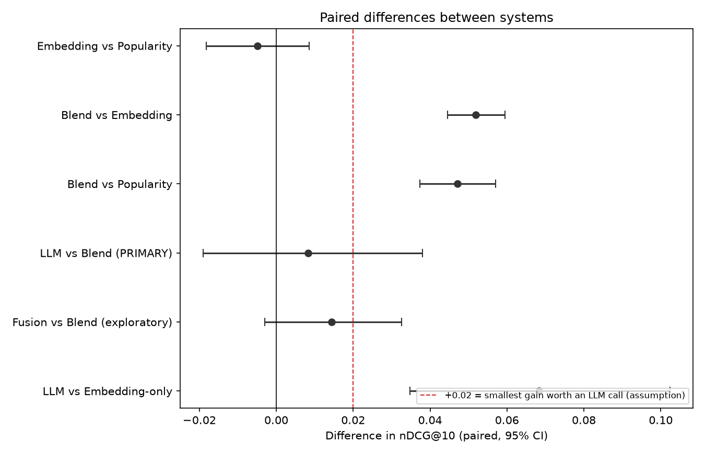

# RecFeed: Is an LLM reranker worth adding to a news feed?

A product-judgment project disguised as a recommender system. The question is not "can I build a recommender?" but **"what is the cheapest ranker that works, and does an LLM step earn its cost?"** I tested it on real click logs, set the success bar before running the LLM test, and report what I found, including the parts that didn't work.

## Result in one table

Test: 3,000 real readers from Microsoft's MIND-small dataset. Each reader's past clicks go in; the system ranks the articles they were shown; the score is how high the clicked ones land (nDCG@10, higher is better).

| System | nDCG@10 | Cost per request |
|---|---|---|
| Random | 0.138 | none |
| Popularity (time-aware click-through rate) | 0.268 | negligible |
| Embedding similarity only | 0.263 | < 1 ms |
| **Similarity + popularity blend** | **0.315** | < 1 ms |
| Blend + local LLM reranker (150 readers) | blend 0.292 → LLM 0.301 | ~21 s on a CPU laptop |

- The blend beats popularity by **+0.047 nDCG@10 (about 18%), 95% CI [+0.037, +0.057]**.
- Similarity alone only ties popularity. The value comes from combining the two.
- The LLM step gave **+0.008, 95% CI [-0.019, +0.038]**: no reliable gain. I had decided in advance that +0.02 was the smallest gain worth an LLM call per request; the data neither reaches nor strictly rules out that bar, but the best estimate is far below it.
- **Recommendation:** ship the blend; keep the LLM out of the per-request path unless a stronger model or larger test shows a clear gain.

Full numbers, caveats and the decision rationale are in [FINDINGS.md](FINDINGS.md).




## How it works

1. **Eval set** (`hist_build_eval_set.py`): one real impression per reader, requiring at least 5 past clicks and 15 candidates; 1,000 cases held aside for tuning, 3,000 for testing. Popularity uses only events that happened *before* each case.
2. **Embedding ranker** (`hist_rank_embeddings.py`): reader profile = average `all-MiniLM-L6-v2` embedding of their last 20 clicks; candidates ranked by similarity.
3. **Blend**: standardized similarity + 0.5 x standardized popularity. The weight is tuned on the separate tuning cases.
4. **LLM reranker** (`hist_llm_rerank.py`): a local `qwen2.5:3b` (via Ollama, CPU only) sees the reader's last 20 clicked titles plus the blend's top 15, and picks its 5 favourites; the rest keep the blend's order. The prompt variant was chosen on tuning cases only (`hist_prompt_check.py`), and the test split is locked to that choice.
5. **Evaluation** (`hist_evaluate.py`): nDCG@10 (primary), AUC, MRR, nDCG@5; paired bootstrap confidence intervals; an "oracle reranker" upper bound; stage-1 recall; latency and a power analysis.

## Honest limitations

- Clicks are not the same as relevance, and logged clicks carry position bias. Offline results are not a substitute for an A/B test.
- One day of traffic from one platform (2019).
- The LLM is a small local model (3B), titles only, with no popularity information in its prompt. The result says nothing about stronger models.
- 150 LLM cases can resolve effects of about +/-0.04 nDCG@10. Detecting a +0.02 gain would take roughly 650.
- The embedding model is generic (not trained on click data). A trained recommender would likely do better; I did not test one.
- Numbers are not comparable to MIND leaderboards because of my filtering.

## What was corrected along the way

The project's early results were wrong in ways worth knowing about: a ground-truth leak that made a popularity baseline score 0.96, a persona benchmark that handed its answer key to the models, and a benchmark whose retrieval "win" disappeared on real clicks. [FINDINGS.md](FINDINGS.md) has the full list, including a first LLM prompt that favoured the first-listed candidates (58% of picks in the first five positions vs 33% by chance) and how I fixed it.

## Repo layout

```
src/
  download_data.py            fetch MIND-small from Hugging Face
  hist_*.py                   the main, history-based experiment (this README)
  build_personas.py, build_embeddings.py, run_baseline.py,
  run_retrieval_only.py, run_retrieval_rerank.py, evaluate.py,
  make_charts.py, inspect_failure_case.py, metrics.py
                              an earlier persona-based benchmark (kept for the record; see FINDINGS.md)
configs/personas.json         personas for the earlier benchmark
results/history_eval/         tables and charts for the main experiment
data/history_eval/            small artefacts: blend weight, chosen prompt variant, raw LLM outputs
```

## Reproduce

Requires Python 3.10+, [Ollama](https://ollama.com), and about 8 GB RAM. No GPU.

```
pip install -r requirements.txt
ollama pull qwen2.5:3b

python src/download_data.py
python src/hist_build_eval_set.py
python src/hist_rank_embeddings.py
python src/hist_evaluate.py                       # also saves the tuned blend weight
python src/hist_llm_rerank.py --split tune --variant pick5_shuffled --n 30
python src/hist_llm_rerank.py --split tune --variant pick5_ranked   --n 30
python src/hist_prompt_check.py                   # picks the prompt variant on tuning cases only
python src/hist_llm_rerank.py --n 150             # ~1 hour on a CPU laptop; resumable
python src/hist_evaluate.py
python src/hist_drift_check.py                    # optional: does popularity go stale within a day?
```

## Data

MIND (Microsoft News Dataset): Wu et al., *MIND: A Large-Scale Dataset for News Recommendation*, ACL 2020. The data is not redistributed here; `download_data.py` fetches it. Check the dataset's license before reuse.
