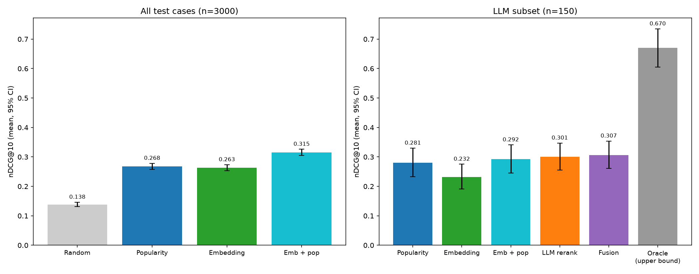
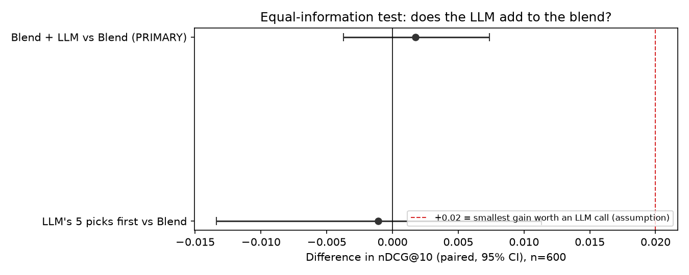

# RecFeed: Is an LLM reranker worth adding to a news feed?

A product-judgment project disguised as a recommender system. The question is not "can I build a recommender?" but **"what is the cheapest ranker that works, and does adding an LLM earn its cost?"** I tested it on real click logs with a free, local model, set the success bar before running the LLM tests, and report what I found, including the parts that didn't work.

## Results

Test: real readers from Microsoft's MIND-small dataset. Each reader's past clicks go in; the system ranks the articles they were shown; the score is how high the clicked ones land (nDCG@10, higher is better).

**1. The cheap rankers: 3,000 held-out readers**

| System | nDCG@10 | Cost per request |
|---|---|---|
| Random | 0.138 | none |
| Popularity (time-aware click-through rate) | 0.268 | negligible |
| Embedding similarity only | 0.263 | < 1 ms |
| **Similarity + popularity blend** | **0.315** | < 1 ms |

**2. Adding a free local LLM on top of the blend: a separate test on 600 of those readers (both rows scored on the same 600)**

| System | nDCG@10 | Cost per request |
|---|---|---|
| Blend | 0.311 | < 1 ms |
| Blend + free local LLM, given everything the blend has | 0.313 | ~56 s on a CPU laptop |
| **Difference** | **+0.002, 95% CI [-0.004, +0.007]** | |

*The blend scores 0.315 on all 3,000 readers and 0.311 on these 600, so compare numbers only within a table.*

- The blend beats popularity by **+0.047 nDCG@10 (about 18%), 95% CI [+0.037, +0.057]**.
- Similarity alone only ties popularity. The value comes from combining the two.
- **Adding the LLM gave a small positive difference, but not a reliable one:** **+0.002, 95% CI [-0.004, +0.007]** on 600 readers. It points the right way, but the margin of error includes zero. The most it could be adding is about +0.007, well under the +0.02 bar I set in advance.
- **The model was chosen because it is free and runs on a laptop CPU** (Qwen2.5-3B). A stronger model could plausibly give a reliable gain; that is the next experiment.
- **Recommendation:** ship the blend now, and keep testing the LLM with a stronger model and a small trained reranker before deciding whether it belongs in the ranking path.

Full numbers, caveats and the decision rationale are in [FINDINGS.md](FINDINGS.md).

Left chart: all 3,000 readers; right chart: an earlier, smaller LLM test (150 readers, titles only).


The equal-information test (600 readers):


## How it works

1. **Eval set** (`hist_build_eval_set.py`): one real impression per reader, requiring at least 5 past clicks and 15 candidates; 1,000 cases held aside for tuning, 3,000 for testing. Popularity uses only events that happened *before* each case.
2. **Embedding ranker** (`hist_rank_embeddings.py`): reader profile = average `all-MiniLM-L6-v2` embedding of their last 20 clicks; candidates ranked by similarity.
3. **Blend**: standardized similarity + 0.5 x standardized popularity. The weight is tuned on the separate tuning cases.
4. **LLM test 1, titles only** (`hist_llm_rerank.py`): a local `qwen2.5:3b` (via Ollama, CPU only) sees the reader's last 20 clicked titles plus the blend's top 15 titles and picks 5. Inconclusive on 150 readers.
5. **LLM test 2, equal information** (`hist_llm_score.py`, `hist_score_check.py`, `hist_evaluate_equal.py`): the same model also sees each candidate's abstract snippet, click rate and similarity; its picks are added to the blend with a weight chosen on tuning cases (weight 0 = the blend). Prompt and weight were chosen on tuning cases only, and the 600-reader test was a single pre-planned look. Swapping in another Ollama model is a one-line change (`LLM_MODEL_NAME`).
6. **Evaluation** (`hist_evaluate.py`, `hist_evaluate_equal.py`): nDCG@10 (primary), AUC, MRR, nDCG@5; paired bootstrap confidence intervals; an "oracle reranker" upper bound; latency and a power analysis.

## Honest limitations

- Clicks are not the same as relevance, and logged clicks carry position bias. Offline results are not a substitute for an A/B test.
- One day of traffic from one platform (2019).
- Everything about the LLM is for **one small, free, local model (3B)** and one prompt family. It also leaned on list position. The result says nothing about stronger models or trained rerankers.
- The embedding model is generic (not trained on click data). A trained recommender would likely do better; I did not test one.
- Numbers are not comparable to MIND leaderboards because of my filtering.

## What I first thought, and what the fair test showed

Two examples. An early persona-based test made embedding retrieval look like a big win, but it had given the models the answer key; on real clicks, similarity alone only ties popularity and the blend is what helps. And my first LLM test gave the model less information than the blend had; the fair test, with equal information, gave the small positive result above. [FINDINGS.md](FINDINGS.md) has the details.

## Repo layout

```
src/
  download_data.py            fetch MIND-small from Hugging Face
  hist_*.py                   the main, history-based experiments (this README)
  build_personas.py, build_embeddings.py, run_baseline.py,
  run_retrieval_only.py, run_retrieval_rerank.py, evaluate.py,
  make_charts.py, inspect_failure_case.py, metrics.py
                              an earlier persona-based benchmark (kept for the record; see FINDINGS.md)
configs/personas.json         personas for the earlier benchmark
results/history_eval/         tables and charts for the main experiments (equal_info/ for test 2)
data/history_eval/            small artefacts: blend weight, chosen prompt settings, raw LLM outputs
```

## Reproduce

Requires Python 3.10+, [Ollama](https://ollama.com), and about 8 GB RAM. No GPU. Test 2 takes about 9 hours on a CPU laptop.

```
pip install -r requirements.txt
ollama pull qwen2.5:3b

python src/download_data.py
python src/hist_build_eval_set.py
python src/hist_rank_embeddings.py
python src/hist_evaluate.py                       # no-LLM results; also saves the tuned blend weight

# test 1: titles only
python src/hist_llm_rerank.py --split tune --variant pick5_shuffled --n 30
python src/hist_llm_rerank.py --split tune --variant pick5_ranked   --n 30
python src/hist_prompt_check.py
python src/hist_llm_rerank.py --n 150
python src/hist_evaluate.py

# test 2: equal information
python src/hist_llm_score.py --split tune --variant content --n 60
python src/hist_llm_score.py --split tune --variant full    --n 60
python src/hist_score_check.py                    # picks prompt and weight on tuning cases only
python src/hist_llm_score.py --n 600              # resumable
python src/hist_evaluate_equal.py

python src/hist_drift_check.py                    # optional: does popularity go stale within a day?
```

## Data

MIND (Microsoft News Dataset): Wu et al., *MIND: A Large-Scale Dataset for News Recommendation*, ACL 2020. The data is not redistributed here; `download_data.py` fetches it. Check the dataset's license before reuse.
